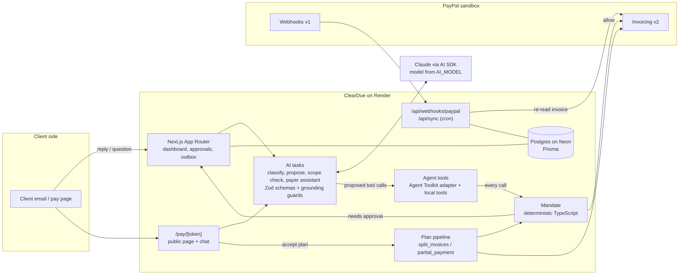

# ClearDue

An AI collections agent for solo Indian freelancers who bill overseas clients through PayPal. ClearDue works out *why* a client hasn't paid (forgot, waiting on approval, short on cash, disputing the work, wrong contact) and takes the matching action, always inside limits the freelancer sets. Clients get an assistant on the pay page that answers questions from the agreed scope, with quotes.


## The problem

85% of freelancers have experienced late payment ([Plutio, citing Freelancers Union](https://www.plutio.com/freelancer-magazine/late-invoice-payments)), and 62% of freelance workers surveyed in New York have lost wages to nonpayment ([Authors Guild and Freelancers Union survey](https://authorsguild.org/news/survey-finds-62-percent-of-ny-freelance-workers-have-lost-wages-due-to-nonpayment)).

Chasing invoices is worse for a solo freelancer in India billing a client in London or Sydney: different time zones, an accounts payable team they've never met, and a payment platform that won't let the client pay in parts. Reminder tools send the same nudge whatever the reason. But "finance hasn't signed off", "cash is tight this month" and "the site breaks on Safari" need three different responses, and the wrong one costs the relationship.

## What it does

| Flow | What happens |
| --- | --- |
| A. Diagnose and act | A client replies to a reminder. ClearDue classifies the reason with a confidence and verbatim evidence, then proposes PayPal actions (reminder to AP, pause, payment plan, message). The mandate decides whether each runs now, waits for approval, or is refused. |
| B. Scope check | "Could you also build it in React?" is checked against the statement of work: in scope, gray zone or out of scope, with quoted clauses and a suggested line item that goes onto a PayPal draft. |
| C. Pay page | A public page per invoice: Pay with PayPal, plan options when they apply, and a chat that answers only from the scope, the invoice and the thread. Anything else goes to the freelancer as a task. |
| D. Payment plans | A plan the client accepts replaces the invoice with new PayPal invoices, so the client always has something payable. |
| E. Close the loop | A verified PayPal webhook (or polling) marks the invoice paid, resolves the case and closes open tasks. |

## Architecture



**LLM proposes, deterministic TypeScript validates.** The model never calls PayPal directly. Every tool call goes through `gate()` in [src/agent/tools.ts](src/agent/tools.ts), which turns it into an `AgentAction` and runs `checkAction()` from [src/agent/mandate.ts](src/agent/mandate.ts) against the freelancer's mandate for that client: autopilot, never auto-contact, minimum confidence, tone ceiling, maximum instalments, minimum first payment, latest final date and quiet hours in the client's time zone. The result is `allow` (runs now), `needs_approval` (queued on Approvals with the draft editable) or `deny` (recorded with reasons, never run). The mandate module has 100% statement and branch coverage (`npm run test:mandate`).

## PayPal APIs used

All calls go to `https://api-m.sandbox.paypal.com`; the client refuses any other host.

| API | Used for |
| --- | --- |
| `POST /v1/oauth2/token` | Client-credentials token, cached until expiry, retried once on 401 |
| `POST /v2/invoicing/invoices` | Create draft invoices (new invoices, plan replacements, scope line items) |
| `PUT /v2/invoicing/invoices/{id}` | Update a draft (add a scope line item) without notifying anyone |
| `POST /v2/invoicing/invoices/{id}/send` | Send an invoice; returns the payer-view link used on the pay page |
| `GET /v2/invoicing/invoices/{id}` | Sync status and paid amount; re-check the original before a plan cancels it |
| `POST /v2/invoicing/invoices/{id}/remind` | Reminders, including `additional_recipients` for an AP contact |
| `POST /v2/invoicing/invoices/{id}/cancel` | Cancel the original silently (`send_to_recipient=false`) when a plan replaces it |
| `POST /v2/invoicing/invoices/{id}/payments` | Record a payment (mock mode's "Simulate client payment") |
| `DELETE /v2/invoicing/invoices/{id}` | Clean up drafts when a plan aborts |
| `POST /v1/notifications/webhooks` | Subscribe `INVOICING.INVOICE.PAID`, `UPDATED`, `CANCELLED`, `REFUNDED` |
| `POST /v1/notifications/verify-webhook-signature` | Verify every incoming event before it is processed |
| `POST /v1/notifications/simulate-event` | Dev script to test simulator events against verification |

### PayPal Agent Toolkit, gated

`@paypal/agent-toolkit` supplies four of the agent's tools: `get_invoice`, `send_invoice_reminder`, `cancel_sent_invoice` and `record_payment_for_invoice`. The toolkit ships AI SDK v4 tools with zod v3 schemas, so [src/agent/toolkit.ts](src/agent/toolkit.ts) lifts each tool's description, JSON schema and `execute`, and never hands `execute` to the model. The model sees the toolkit's schema, but calling the tool runs the mandate gate first; only an `allow` reaches the toolkit. The adapter imports `server-only`, and the client bundle contains no toolkit or zod v3 code. ClearDue's own tools (`send_message`, `pause_reminders`, `offer_payment_plan`) go through the same gate.

### The India constraint

PayPal doesn't allow partial payments on invoices from merchants in India, Brazil or Israel. ClearDue picks a plan strategy from the freelancer's country, behind one pipeline ([src/plans](src/plans)):

- `split_invoices` (IN, BR, IL): the original invoice is replaced by one PayPal invoice per instalment.
- `partial_payment` (everyone else): one replacement invoice that accepts part payments, with the first instalment as the minimum.

Either way the client always has something payable: the new drafts are created first, the original is re-read and only cancelled if it is still unpaid (silently), then the drafts are sent. If a send fails after the cancel, the plan stays `pending_send` and polling retries it. Amounts are integer minor units everywhere, and plans always sum exactly.

## AI usage

Every AI call uses the [AI SDK](https://ai-sdk.dev) with Anthropic's Claude; the model name comes from `AI_MODEL`. Prompts live in [src/ai/prompts](src/ai/prompts), and every output is parsed by a Zod schema ([src/ai/schemas.ts](src/ai/schemas.ts)) before anything uses it. Each call is capped at 20 seconds; on timeout or a bad response the task returns a readable fallback that sends the work to a human.

| Task | Output | Guard in code |
| --- | --- | --- |
| `classifyReply` | Reason, confidence, verbatim evidence, promised date, approver email | Evidence must appear in the client's own words, or confidence drops to 0.5 or below |
| `proposeAction` | Tool calls | Mandate gate on every call |
| `scopeCheck` | Verdict, quoted clauses, hours, suggested line item | A verdict whose clauses aren't verbatim in the scope becomes GRAY_ZONE |
| `payerAssistant` | Answer, citations, escalate, complaint, plan request | Citations must be verbatim in the named source; any money figure not in the sources (or computed by code: total, outstanding, paid, plan options) forces an escalation |

An overdue invoice with no client reply never reaches the model: code marks it `no_response` ("No reply yet").

### Evals

[evals/replies.json](evals/replies.json) holds 30 client replies, at least three per reason, including mixed reasons (a dispute outranks cash), relative dates ("Friday", "end of the month") and a prompt injection.

```bash
npm run eval
```

It runs each reply through `classifyReply` with the live model (it ignores `DEMO_MODE`, and needs `ANTHROPIC_API_KEY` and `AI_MODEL`), prints overall and per-reason accuracy plus promised-date resolution, lists the misses, and writes `evals/last-run.json`.

### Demo mode

With `DEMO_MODE=true`, recorded responses are replayed for the seeded stories (Acme's diagnosis and scope check, Brightside's plan, Koala's pay-page questions); any other prompt goes to the live model. Every replayed answer is labelled "Replayed response" in the UI, so a demo never passes off a recording as a live call. The hosted demo runs with `DEMO_MODE=false`.

## Local setup

Requirements: Node 24, Docker.

```bash
npm install
cp .env.example .env          # then fill in the values (see below)
docker compose up -d          # Postgres on localhost:5433
npx prisma migrate dev
npm run seed                  # demo data
npm run dev                   # http://localhost:3000
```

Sign in with `DEMO_EMAIL` / `DEMO_PASSWORD` from `.env`.

### Mock mode (no PayPal account needed)

Set `PAYPAL_MODE=mock` to run against an in-process fake of the Invoicing API (state in `.paypal-mock.json`). It behaves like an Indian merchant account (partial payments refused) and shows a "PayPal mock mode" banner. Invoice pages get a **Simulate client payment** button that records the payment and runs the same handler as a verified `INVOICING.INVOICE.PAID` webhook. In mock mode, `npm run seed` seeds through the fake, so every flow, including Brightside's split plan, works end to end. With `NODE_ENV=production`, mock mode throws instead of running.

### PayPal sandbox setup

1. Sign in at [developer.paypal.com](https://developer.paypal.com) and open **Testing Tools > Sandbox Accounts**.
2. Create a **Business** account: this is the freelancer (the invoicer). Pick **India** as the country to match the demo story.
3. Create a **Personal** account: this is the client who pays. Put its email in `SEED_CLIENT_EMAIL` (and `SPIKE_PAYER_EMAIL`).
4. Under **Apps & Credentials** (Sandbox tab), create an app linked to the Business account. Copy its Client ID and Secret into `PAYPAL_CLIENT_ID` and `PAYPAL_CLIENT_SECRET`.
5. Sandbox emails (invoices, reminders) don't reach real inboxes. View them under **Testing Tools > Sandbox Notifications**.

Check the account works end to end, then seed real sandbox invoices:

```bash
npm run paypal:spike
```

```bash
npm run seed:paypal
```

The spike creates, sends, reminds and silently cancels a USD invoice, tests whether `partial_payment` is allowed for the account, and writes the results to `docs/progress/paypal-spike.json`.

### Webhooks and polling

Create the webhook once the app has a public URL (Render, or a tunnel locally):

```bash
npm run paypal:webhook -- create https://<your-app>/api/webhooks/paypal
```

Put the printed id in `PAYPAL_WEBHOOK_ID`. Every event is checked with verify-webhook-signature and stored in the `WebhookEvent` table (idempotent by event id). The payload is never trusted for state: ClearDue re-reads the invoice from PayPal.

PayPal's webhook simulator sends mock events that [cannot pass verify-webhook-signature](https://developer.paypal.com/api/rest/webhooks/simulator/). They are rejected (and labelled) unless `ALLOW_UNVERIFIED_WEBHOOKS=true` outside production. Real sandbox payments produce verifiable events.

Because webhooks can be late or missing, `POST /api/sync` (bearer `CRON_SECRET`) re-syncs open invoices, ends expired pauses and retries pending plan sends. The Render blueprint runs it every 5 minutes, and the dashboard also triggers it after each load.

## Environment variables

See [.env.example](.env.example). Never commit `.env`.

| Variable | Purpose |
| --- | --- |
| `DATABASE_URL` | Postgres connection string (local Docker or Neon) |
| `PAYPAL_MODE` | `sandbox` (default) or `mock`: the in-process fake described above. Refused in production |
| `PAYPAL_CLIENT_ID`, `PAYPAL_CLIENT_SECRET` | Sandbox REST app credentials |
| `PAYPAL_BASE_URL` | Must be `https://api-m.sandbox.paypal.com` |
| `PAYPAL_WEBHOOK_ID` | Webhook ID used by verify-webhook-signature |
| `ALLOW_UNVERIFIED_WEBHOOKS` | Dev only: process events that fail verification (PayPal's simulator). Ignored when `NODE_ENV=production` |
| `ANTHROPIC_API_KEY`, `AI_MODEL` | Claude access; the model name is read from env |
| `DEMO_MODE` | `true` replays recorded AI responses for the seeded stories, labelled in the UI. The hosted demo runs with `false` (live calls) |
| `DEMO_EMAIL`, `DEMO_PASSWORD`, `SESSION_PASSWORD` | Single demo login; the session secret needs 32+ characters |
| `APP_URL` | Public base URL for client pay-page links |
| `CRON_SECRET` | Protects the polling sync endpoint |
| `SEED_CLIENT_EMAIL`, `SEED_AP_EMAIL` | Sandbox personal account and AP inbox used by the seed |

## Deploy (Render + Neon)

1. Create a Neon Postgres database and copy its connection string.
2. In Render, create a Blueprint from this repo; it picks up [render.yaml](render.yaml) (Starter web service and the sync cron job).
3. Set `DATABASE_URL` and the other `sync: false` variables in the Render dashboard. Migrations run in the pre-deploy step.
4. Seed once from your machine against Neon: `DATABASE_URL=<neon url> npm run seed:paypal`.

## Tests

```bash
npm test
```

```bash
npm run test:mandate
```

```bash
npm run typecheck
```

Unit tests cover the mandate, plan maths and the plan pipeline against a fake PayPal, the mock PayPal lifecycle, the AI guards (including adversarial pay-page questions: invented discounts, made-up quotes, prompt injection) and the eval scorer.

## Limitations

- Sandbox only. Live PayPal credentials are never used, and the client refuses any host but the sandbox.
- Emails to clients go to an Outbox for the freelancer to send; ClearDue doesn't send email itself. PayPal's own invoice and reminder emails are sent by PayPal.
- One freelancer per deployment (single demo login).
- The pay-page rate limiter is in process memory: fine for one instance, not several.
- The mock doesn't model zero-decimal currencies (JPY and similar); the plan maths does.
- Eval accuracy depends on the model in `AI_MODEL`; run `npm run eval` to measure it.

## License

[MIT](LICENSE)
