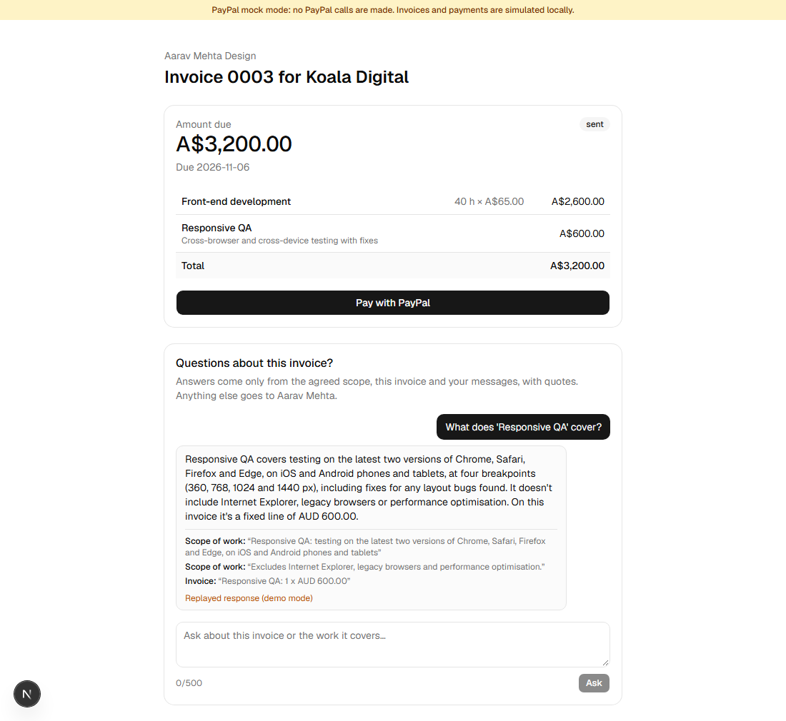
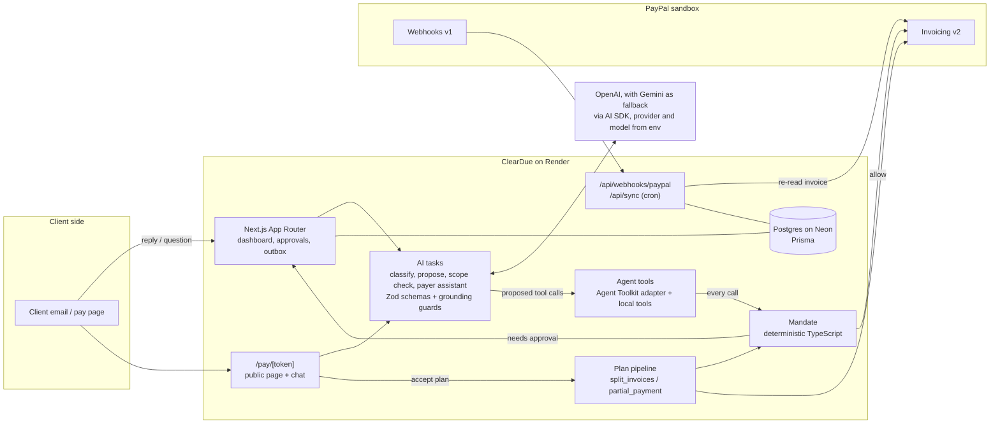
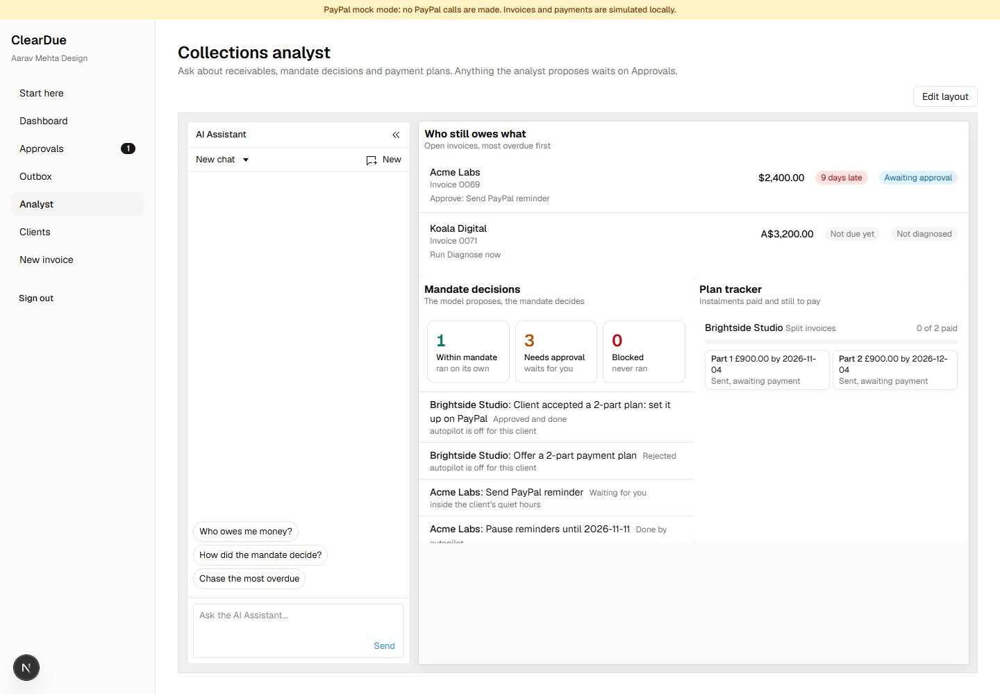

# ClearDue

An AI collections agent for solo Indian freelancers who bill overseas clients through PayPal. ClearDue works out *why* a client hasn't paid (forgot, waiting on approval, short on cash, disputing the work, wrong contact) and takes the matching action, always inside limits the freelancer sets. Clients get an assistant on the pay page that answers questions from the agreed scope, with quotes.

**Live demo:** <https://cleardue-6laj.onrender.com> (PayPal sandbox; the login is under [Testing instructions](#testing-instructions)).



## The problem

85% of freelancers have experienced late payment ([Plutio, citing Freelancers Union](https://www.plutio.com/freelancer-magazine/late-invoice-payments)), and in a survey of New York freelance workers, 91% "reported experiencing late or overdue wages at least once in their career" ([Authors Guild, Freelancers Union and others](https://authorsguild.org/news/survey-finds-62-percent-of-ny-freelance-workers-have-lost-wages-due-to-nonpayment)).

Chasing invoices is worse for a solo freelancer in India billing a client in London or Sydney: different time zones, an accounts payable team they've never met, and a payment platform that won't let the client pay in parts. Reminder tools send the same nudge whatever the reason. But "finance hasn't signed off", "cash is tight this month" and "the site breaks on Safari" need three different responses, and the wrong one costs the relationship.

## What it does

| Flow | What happens |
| --- | --- |
| A. Diagnose and act | A client replies to a reminder. ClearDue classifies the reason with a confidence and verbatim evidence, then proposes PayPal actions (reminder to AP, pause, payment plan, message). The mandate decides whether each runs now, waits for approval, or is refused. |
| B. Scope check | "Could you also build it in React?" is checked against the statement of work: in scope, gray zone or out of scope, with quoted clauses and a suggested line item that goes onto a PayPal draft. |
| C. Pay page | A public page per invoice: Pay with PayPal, plan options when they apply, and a chat that answers only from the scope, the invoice and the thread. Anything else goes to the freelancer as a task. |
| D. Payment plans | Plan options appear on the pay page for a cash-constraint diagnosis, a request in the chat, or a plan the freelancer approved. When the client accepts, the mandate decides: with autopilot on (or a plan the freelancer already approved) it runs at once; with autopilot off it waits on Approvals and the page says the freelancer will confirm. Running a plan replaces the invoice with new PayPal invoices, so the client always has something payable. |
| E. Close the loop | A verified PayPal webhook (or polling) marks the invoice paid, resolves the case and closes open tasks. |

## Architecture



**LLM proposes, deterministic TypeScript validates.** The model never calls PayPal directly. Every tool call goes through `gate()` in [src/agent/tools.ts](src/agent/tools.ts), which turns it into an `AgentAction` and runs `checkAction()` from [src/agent/mandate.ts](src/agent/mandate.ts) against the freelancer's mandate for that client: autopilot, never auto-contact, minimum confidence, tone ceiling, maximum instalments, minimum first payment, latest final date and quiet hours in the client's time zone. The result is `allow` (runs now), `needs_approval` (queued on Approvals with the draft editable) or `deny` (recorded with reasons, never run). The mandate module has 100% statement and branch coverage (`npm run test:mandate`).

## Collections analyst (AG Studio)



`/analyst` is an [AG Studio](https://www.ag-grid.com/studio/) dashboard for the freelancer, built on the Studio Agent Framework:

- **Three custom widgets** ([widgets.tsx](src/app/(app)/analyst/widgets.tsx)): *Who still owes what* (open invoices, most overdue first, with the diagnosed reason and next action), *Mandate decisions* (how many proposals the mandate allowed, held for approval or blocked, with reasons) and *Plan tracker* (each payment plan's instalments and progress). They are registered with `createWidgets`, so they take part in Studio's filters, editor and AI like the built-in widgets.
- **Theme and report:** a Studio theme mapped to the app's colours and type, and a default report with the three widgets. The data sources are read server-side for the signed-in freelancer.
- **A custom agent on a swapped-in harness:** the collections analyst is a Client Tool Runner ([analyst-studio.tsx](src/app/(app)/analyst/analyst-studio.tsx)) whose server side ([route.ts](src/app/api/analyst/run/route.ts)) runs the app's model (Gemini or Claude) in a tool loop over read tools (receivables, decisions, plans) and four propose tools. Studio's AI panel is the front end, and our own server is the harness: we don't use Studio's built-in agents or their LLM adapter. That is the "custom agent / swapped-in harness" option the AG Grid prize describes, and it keeps the model, its key and the mandate gate on the server, never in the browser.
- **Its proposals go through the mandate and always to Approvals.** The same check as the diagnosis agent runs, but the analyst can never auto-run anything: an action the mandate would allow is downgraded to "needs your approval", and a mandate denial stays a denial ([analyst.ts](src/agent/analyst.ts), [tests](src/agent/analyst.test.ts)). Approving a proposal checks the mandate again.

On a phone the report comes first, with the three widgets stacked and the AI panel opened by "Ask the analyst"; empty widgets say what to do next. AG Studio is a commercial component. The hackathon trial key goes in `AG_STUDIO`, never in the repo; without it Studio shows a trial watermark and logs a licence notice.

## PayPal APIs used

All calls go to `https://api-m.sandbox.paypal.com`; the client refuses any other host.

| API | Used for |
| --- | --- |
| `POST /v1/oauth2/token` | Client-credentials token, cached until expiry, retried once on 401 |
| `POST /v2/invoicing/invoices` | Create draft invoices (new invoices, plan replacements, scope line items) |
| `PUT /v2/invoicing/invoices/{id}` | Update a draft (add a scope line item) without notifying anyone |
| `POST /v2/invoicing/invoices/{id}/send` | Send an invoice; returns the payer-view link used on the pay page |
| `GET /v2/invoicing/invoices/{id}` | Sync status and paid amount; re-check the original before a plan cancels it |
| `POST /v2/invoicing/invoices/{id}/remind` | Reminders, including `additional_recipients` for an AP contact |
| `POST /v2/invoicing/invoices/{id}/cancel` | Cancel the original silently (`send_to_recipient=false`) when a plan replaces it |
| `POST /v2/invoicing/invoices/{id}/payments` | Record a payment (mock mode's "Simulate client payment") |
| `DELETE /v2/invoicing/invoices/{id}` | Clean up drafts when a plan aborts |
| `POST /v1/notifications/webhooks` | Subscribe `INVOICING.INVOICE.PAID`, `UPDATED`, `CANCELLED`, `REFUNDED` |
| `POST /v1/notifications/verify-webhook-signature` | Verify every incoming event before it is processed |
| `POST /v1/notifications/simulate-event` | Dev script to test simulator events against verification |

### PayPal Agent Toolkit, gated

`@paypal/agent-toolkit` supplies four of the agent's tools: `get_invoice`, `send_invoice_reminder`, `cancel_sent_invoice` and `record_payment_for_invoice`. The toolkit ships AI SDK v4 tools with zod v3 schemas, so [src/agent/toolkit.ts](src/agent/toolkit.ts) lifts each tool's description, JSON schema and `execute`, and never hands `execute` to the model. The model sees the toolkit's schema, but calling the tool runs the mandate gate first; only an `allow` reaches the toolkit. The adapter imports `server-only`, and the client bundle contains no toolkit or zod v3 code. ClearDue's own tools (`send_message`, `pause_reminders`, `offer_payment_plan`) go through the same gate.

The toolkit's source and README are at [github.com/paypal/agent-toolkit](https://github.com/paypal/agent-toolkit), and its documentation is at [paypal.gitbook.com](https://paypal.gitbook.com/agent-toolkit-and-mcp-server/agent-toolkit). The official tool reference, [docs.paypal.ai/developer/tools/ai/agent-tools-ref](https://docs.paypal.ai/developer/tools/ai/agent-tools-ref), currently redirects to a PayPal 404 page. [github.com/paypal/AI-Toolkit](https://github.com/paypal/AI-Toolkit) is a different product: a plugin for coding agents (Claude Code, Codex, Cursor) that adds PayPal skills and the sandbox MCP server to the development workflow, not a runtime library.

### The India constraint

PayPal doesn't allow partial payments on invoices from merchants in India, Brazil or Israel. ClearDue picks a plan strategy from the freelancer's country, behind one pipeline ([src/plans](src/plans)):

- `split_invoices` (IN, BR, IL): the original invoice is replaced by one PayPal invoice per instalment.
- `partial_payment` (everyone else): one replacement invoice that accepts part payments, with the first instalment as the minimum.

**Sandbox note.** The sandbox REST app the current build was tested with is not India-registered: PayPal accepted `configuration.partial_payment` on it and kept the flag, and its API doesn't reveal the business account's country. So the strategy is chosen from `Freelancer.country` in our database (the demo freelancer is `IN`), not from the PayPal account, and the demo exercises `split_invoices` against an account that could also do `partial_payment`. The credentials come only from `PAYPAL_CLIENT_ID` / `PAYPAL_CLIENT_SECRET`, so switching to another sandbox app is an env change.

Either way the client always has something payable: the new drafts are created first, the original is re-read and only cancelled if it is still unpaid (silently), then the drafts are sent. If a send fails after the cancel, the plan stays `pending_send` and polling retries it. Amounts are integer minor units everywhere, and plans always sum exactly.

### Why not PayPal Pay Later?

Pay Later lets the payer spread the cost while the merchant is paid in full, which would suit a short-on-cash client. But PayPal offers it only to merchants based in a few countries: the [US eligibility rules](https://developer.paypal.com/docs/checkout/pay-later/us/) require a US-based merchant, and the other supported merchant countries are the UK, Australia, Canada, France, Germany, Italy and Spain. India isn't one of them, so it can't serve ClearDue's freelancers. Split invoices work for a merchant in any country. Pay Later is a possible future option for freelancers based in those countries.

## AI usage

Every AI call uses the [AI SDK](https://ai-sdk.dev). The primary provider is OpenAI (`gpt-5.4-mini`), with Google Gemini (`gemini-3.5-flash-lite`) as the fallback. Both are chosen by env (`AI_PROVIDER` / `AI_MODEL`, and `AI_FALLBACK_PROVIDER` / `AI_FALLBACK_MODEL`), and Anthropic Claude is supported too, so the provider is swappable. All three support the tool calling and structured output the tasks need. Prompts live in [src/ai/prompts](src/ai/prompts), and every output is parsed by a Zod schema ([src/ai/schemas.ts](src/ai/schemas.ts)) before anything uses it. Each call is capped at 20 seconds and each user action has an overall time budget across retries, failover and tool steps (45 seconds for a diagnosis, 20 seconds for a pay-page answer, scope check or analyst turn); on timeout or a bad response the task returns a readable fallback that sends the work to a human. Every live answer says which provider and model produced it ("Answered by OpenAI gpt-5.4-mini", "Diagnosed by Gemini gemini-3.5-flash-lite"), including after a failover.

| Task | Output | Guard in code |
| --- | --- | --- |
| `classifyReply` | Reason, confidence, verbatim evidence, promised date, approver email | Evidence must appear in the client's own words, or confidence drops to 0.5 or below |
| `proposeAction` | Tool calls | Mandate gate on every call |
| `scopeCheck` | Verdict, quoted clauses, hours, suggested line item | A verdict whose clauses aren't verbatim in the scope becomes GRAY_ZONE |
| `payerAssistant` | Answer, citations, escalate, complaint, plan request | Citations must be verbatim in the named source; any money figure not in the sources (or computed by code: total, outstanding, paid, plan options) forces an escalation |

An overdue invoice with no client reply never reaches the model: code marks it `no_response` ("No reply yet").

**Data use.** Content sent to a provider is demo data (made-up clients and invoices). OpenAI's API doesn't use API content for training by default. Gemini's free tier does allow Google to use content to improve its products and limits some models to about 20 requests a day, and the Gemini fallback runs on the free tier here, which is fine only because the content is made up (it is used only when OpenAI is unavailable); production would use paid tiers for both. One key per provider is used, and quotas are never worked around with extra keys.

**Failover and rate limits.** If the primary provider answers with a rate limit or spent quota (429), any 5xx, a rejected key (401/403) or has no key configured, the same request goes once to the secondary, which retries once after a short backoff (4 seconds, or the provider's Retry-After, capped at 10; a spent daily quota skips the wait). Other errors, like a bad request, don't fail over. If the secondary fails too, a seed story gets its recorded response, labelled "Replayed response"; anything else uses the task's readable fallback that sends the work to a human. The answer is labelled with the provider that actually produced it.

**Response cache (demo account only).** The first live result of a diagnosis, scope check or pay-page answer is stored, and an identical request later reuses it, labelled "Cached result from an earlier live run" (never passed off as a fresh call). Identical means the same model, prompt, replies, scope text, question and day, so a different reply, a new day or a changed prompt always calls the model. Only the demo freelancer has a cache, replayed and failed results are never stored, and the tool-calling step that proposes actions is not cached. Reset demo keeps cached results while the seed stories are unchanged (a fingerprint of them is part of every entry) and deletes entries made under other stories.

**Misreads fail safe.** The model only proposes; code decides. A vague reply that gets read as a reason still has to clear the mandate: nothing contacts a client unless autopilot is on, the confidence is at least the client's threshold (0.85 by default) and it isn't in the client's quiet hours; money actions (cancel, record payment) always need approval; and a case in dispute stops all automation. In the eval's two ambiguous misses ("Thanks for the update.", read as `forgot` at confidence 0.5, and "Let me check and get back to you.", at 0.8), the friendly nudge would have waited in Approvals, not been sent ([mandate tests](src/agent/mandate.test.ts)).

### Evals

Two labelled sets, reported separately:

- [evals/synthetic.json](evals/synthetic.json): 30 replies written for the reasons as defined, at least three per reason, including mixed reasons (a dispute outranks cash), relative dates ("Friday", "end of the month") and a prompt injection.
- [evals/real.json](evals/real.json): anonymized real client replies with their labels. A case can carry its own `today` (the day it was sent) so relative dates resolve correctly.

```bash
npm run eval
```

It runs each reply through `classifyReply` with the live primary model (it ignores `DEMO_MODE` and failover, and needs `AI_MODEL` and the key for `AI_PROVIDER`). Calls are paced at one every 6 seconds (`EVAL_DELAY_MS`), which suits Gemini's free tier; use `EVAL_DELAY_MS=0` on a paid tier. For each set it prints overall and per-reason accuracy, latency (average and p95) and promised-date resolution, lists the misses, then writes `evals/last-run.json` (or `EVAL_OUT`). `npm run eval -- real` runs one set. `npm run ai:compare` runs fixed scenarios for the other AI tasks (scope check, pay-page assistant, the proposal tool loop through the real mandate gate, and the analyst agent) against one provider.

Live runs of the synthetic set (saved in [evals/results](evals/results)). On `gemini-3.5-flash-lite` the first run scored 28 of 30 (93%), where the two misses were the ambiguous replies above, read as `forgot`. After tightening the `other` guidance in the classify prompt it scored 29 of 30 and then 30 of 30, with 4 of 4 promised dates resolved each time. The model is not deterministic: the 29 had one different miss (the prompt-injection case read as `claims_paid`, which the mandate would also have held for approval), so expect a point either way between runs.

### Choosing the provider (2026-11-04)

Same 30 replies and the same fixed task scenarios against each model, one provider at a time with no failover (raw results in [evals/results](evals/results)). The scenarios were 4 scope checks, 5 pay-page questions (including a prompt injection), 4 proposal tool loops through the real mandate gate (each must call the right tool with no invalid input) and 2 analyst questions (one reads, one proposes).

| Model | Eval accuracy | Eval latency (avg, p95) | Scope | Pay page | Proposals | Analyst |
| --- | --- | --- | --- | --- | --- | --- |
| **OpenAI gpt-5.4-mini, no reasoning (primary)** | 30/30 | 2.4 s, 3.4 s | 4/4 | 5/5 | 4/4 | 2/2 |
| OpenAI gpt-5.4-mini, low reasoning | 30/30 | 3.1 s, 4.5 s | 4/4 | 5/5 | 4/4 | 2/2 |
| OpenAI gpt-5.4-nano | 30/30 | 2.6 s, 3.9 s | 1/4 | passed all but my own check | 4/4 | 2/2 |
| OpenAI gpt-4.1-mini | 29/30 | 1.9 s, 2.3 s | not run | not run | not run | not run |
| Gemini gemini-3.5-flash-lite (fallback) | 30/30 | 4.3 s, 7.2 s | 4/4 | 5/5 | see below | see below |

The Gemini tool-loop rows could not be measured cleanly. A first run was cut short by a network drop (its file was overwritten by the later run, so the Gemini scope and pay-page cells come from that run's console output), and from mid-afternoon the Gemini API was slow for everything: a one-word request took 28 to 31 seconds, and a later full run scored 0/4 on scope checks, 4/5 on the pay page, 0/4 on proposals and 1/2 on the analyst, nearly all of it timeouts at 20 to 60 seconds. That is a snapshot, not a verdict on the model, but it is the reliability the primary has to beat.

**Decision:** `gpt-5.4-mini` with reasoning off is the primary. Accuracy is equal to Gemini's (100% on the eval and on every task scenario), it is steadier, and it is about twice as fast. `gpt-5.4-nano` is cheaper but called React and copywriting requests gray zone and a third revision round in scope, so it is out. Reasoning "low" gave the same accuracy about 30% slower; `OPENAI_REASONING_EFFORT` changes it. Gemini stays configured as the fallback, which is what the failover is for. The eval has no real replies yet (`evals/real.json` is empty), so a harder real set could change the ranking.

On the free tier some Gemini models allow only about 20 requests a day (`gemini-3.6-flash`, `gemini-3.5-flash`); the eval runner stops early, and says so, after three AI errors in a row.

### Demo mode

With `DEMO_MODE=true`, recorded responses are replayed for the seeded stories (Acme's diagnosis and scope check, Brightside's plan, Koala's pay-page questions); any other prompt goes to the live model. Every replayed answer is labelled "Replayed response" in the UI, so a demo never passes off a recording as a live call. The hosted demo runs with `DEMO_MODE=false`.

## Local setup

Requirements: Node 24, Docker.

```bash
npm install
cp .env.example .env          # then fill in the values (see below)
docker compose up -d          # Postgres on localhost:5433
npx prisma migrate dev
npm run seed                  # demo data
npm run dev                   # http://localhost:3000
```

### Demo login

Hosted demo: [cleardue-6laj.onrender.com](https://cleardue-6laj.onrender.com), email `demo@cleardue.app`, password `judge-cleardue-2026`. This is a demo-only account shared by all judges, with sandbox PayPal only.

Locally, sign in with `DEMO_EMAIL` / `DEMO_PASSWORD` from `.env`. When `DEMO_MODE=true` or `PAYPAL_MODE=mock`, the login page shows these credentials and fills them in. After sign-in, **Start here** walks through the three demo stories (Acme, Brightside, Koala); it can be dismissed and stays in the menu.

Because judges share one account, **Reset demo** on Start here puts the three stories back at their starting point (after a confirmation). It touches only the demo freelancer's data, and with PayPal connected it first cancels the open invoices from the previous run (deleting drafts), so PayPal and the database stay consistent. With `DEMO_DAILY_RESET=true` (set in render.yaml) the sync cron does the same reset once a day at 03:00 UTC, and Start here shows the next one in the viewer's timezone. Reset demo works at most once every 5 minutes across all judges, so two judges can't wipe each other's run back to back. `npm run seed` / `npm run seed:paypal` run the same reset from the command line.

With PayPal connected, a reset also adds a fourth client, **Northwind Media**, with a finished history so the analyst's widgets have data from the start. That history is generated by running the real pipeline, not by writing rows ([demo-history.ts](src/lib/demo-history.ts)): a recorded client reply is classified, the agent's three recorded proposals go through the mandate (one allowed, one held for approval and then approved, one blocked for a firm tone above the client's ceiling), the client accepts the plan, PayPal splits the invoice, and both parts are paid. The three demo stories are untouched, and the recordings are labelled as replayed.

### Mock mode (no PayPal account needed)

Set `PAYPAL_MODE=mock` to run against an in-process fake of the Invoicing API (state in `.paypal-mock.json`). It behaves like an Indian merchant account (partial payments refused) and shows a "PayPal mock mode" banner. Invoice pages get a **Simulate client payment** button that records the payment and runs the same handler as a verified `INVOICING.INVOICE.PAID` webhook. In mock mode, `npm run seed` seeds through the fake, so every flow, including Brightside's split plan, works end to end. With `NODE_ENV=production`, mock mode throws instead of running, unless `ALLOW_MOCK_IN_PROD=true` (for checking a deploy before sandbox credentials are set; the banner still shows). Mock state is a file on the server, so on Render seed from the service's shell (`npm run seed`) rather than your machine, and reseed after each deploy: the disk is not persistent.

### PayPal sandbox setup

1. Sign in at [developer.paypal.com](https://developer.paypal.com) and open **Testing Tools > Sandbox Accounts**.
2. Create a **Business** account: this is the freelancer (the invoicer). Pick **India** as the country to match the demo story.
3. Create a **Personal** account: this is the client who pays. Put its email in `SEED_CLIENT_EMAIL` (and `SPIKE_PAYER_EMAIL`).
4. Under **Apps & Credentials** (Sandbox tab), create an app linked to the Business account. Copy its Client ID and Secret into `PAYPAL_CLIENT_ID` and `PAYPAL_CLIENT_SECRET`.
5. Sandbox emails (invoices, reminders) don't reach real inboxes. View them under **Testing Tools > Sandbox Notifications**.

Check the account works end to end, then seed real sandbox invoices:

```bash
npm run paypal:spike
```

```bash
npm run seed:paypal
```

The spike creates, sends, reminds and silently cancels a USD invoice, tests whether `partial_payment` is allowed for the account, and writes the results to `docs/progress/paypal-spike.json`.

### Webhooks and polling

Create the webhook once the app has a public URL (Render, or a tunnel locally):

```bash
npm run paypal:webhook -- create https://<your-app>/api/webhooks/paypal
```

Put the printed id in `PAYPAL_WEBHOOK_ID`. Every event is checked with verify-webhook-signature and stored in the `WebhookEvent` table (idempotent by event id). The payload is never trusted for state: ClearDue re-reads the invoice from PayPal.

PayPal's webhook simulator sends mock events that [cannot pass verify-webhook-signature](https://developer.paypal.com/api/rest/webhooks/simulator/). They are rejected (and labelled) unless `ALLOW_UNVERIFIED_WEBHOOKS=true` outside production. Real sandbox payments produce verifiable events.

Because webhooks can be late or missing, `POST /api/sync` (bearer `CRON_SECRET`) re-syncs open invoices, ends expired pauses and retries pending plan sends. The Render blueprint runs it every 5 minutes, and the dashboard also triggers it after each load.

## Testing instructions

For judges (also pasted into Devpost):

1. Open the hosted demo, <https://cleardue-6laj.onrender.com>, and sign in with `demo@cleardue.app` / `judge-cleardue-2026`. The hosted demo runs on a PayPal sandbox app whose credentials aren't in the repo: every invoice and payment is fake money, and no real money moves.

   To pay a client invoice you have two options on its pay page: **Pay with PayPal** opens PayPal's sandbox checkout, where you can sign in with your own sandbox personal account; or **Mark as paid (sandbox test)** records the payment through the Invoicing API, with no account needed. Either way PayPal's signed webhook marks the invoice paid and closes the case.
2. You land on **Start here**, with three stories, each about a minute:
   - **Acme Labs, autopilot acts with no click.** Open Acme's invoice and click **Diagnose now**. The agent reads Dana's "waiting on finance sign-off" reply, then sends a PayPal reminder to Acme's AP contact and pauses reminders. Both show on the timeline as done by autopilot, within the mandate; Approvals stays empty.
   - **Brightside Studio, approval path and a payment plan.** Open Brightside's invoice and click **Diagnose now** (Sam: "cash is tight this month"). Open the pay page link and accept a two-part plan: autopilot is off for this client, so the page says Aarav will confirm. Approve it under **Approvals**; the pay page updates to two smaller PayPal invoices.
   - **Koala Digital, the client's pay page.** Ask the chat a scope question (for example "Is Safari testing included?") and get an answer quoting the scope. Ask to split the payment to see plan options. Pay it with either option above; the invoice shows **Paid (recorded)** or **Paid**, and the case closes.
3. If a story is already finished (another judge got there first), click **Reset demo** on Start here (at most once every 5 minutes). The demo also resets itself daily at 03:00 UTC.

Acme's reminder is client contact, so the mandate holds it during the client's quiet hours (20:00 to 08:00 New York time). At night there, Start here says so: the diagnosis still runs and the reminder waits in Approvals. For autopilot acting at night, use Koala's plan, or try Acme during New York daytime.

## Environment variables

See [.env.example](.env.example). Never commit `.env`.

| Variable | Purpose |
| --- | --- |
| `DATABASE_URL` | Postgres connection string (local Docker or Neon) |
| `PAYPAL_MODE` | `sandbox` (default) or `mock`: the in-process fake described above. Refused in production unless `ALLOW_MOCK_IN_PROD=true` |
| `ALLOW_MOCK_IN_PROD` | `true` lets mock mode run in production for a deploy check, with the banner shown. Leave unset for the real deploy |
| `PAYPAL_CLIENT_ID`, `PAYPAL_CLIENT_SECRET` | Sandbox REST app credentials |
| `PAYPAL_BASE_URL` | Must be `https://api-m.sandbox.paypal.com` |
| `PAYPAL_WEBHOOK_ID` | Webhook ID used by verify-webhook-signature |
| `ALLOW_UNVERIFIED_WEBHOOKS` | Dev only: process events that fail verification (PayPal's simulator). Ignored when `NODE_ENV=production` |
| `AI_PROVIDER`, `AI_MODEL` | The primary provider (`openai`, `google` or `anthropic`) and its model, e.g. `openai` and `gpt-5.4-mini`; never hard-coded |
| `AI_FALLBACK_PROVIDER`, `AI_FALLBACK_MODEL` | Optional secondary, e.g. `google` and `gemini-3.5-flash-lite`: takes over once per request on a quota error, a 5xx, a rejected key or a missing key on the primary |
| `OPENAI_API_KEY` | OpenAI key (when OpenAI is the primary or the fallback) |
| `GOOGLE_GENERATIVE_AI_API_KEY` | Gemini key from Google AI Studio (when Gemini is used) |
| `ANTHROPIC_API_KEY` | Only when `anthropic` is used |
| `OPENAI_REASONING_EFFORT` | Optional: `none` (default), `minimal`, `low`, `medium` or `high` for OpenAI reasoning models |
| `DEMO_MODE` | `true` replays recorded AI responses for the seeded stories, labelled in the UI. The hosted demo runs with `false` (live calls) |
| `DEMO_EMAIL`, `DEMO_PASSWORD`, `SESSION_PASSWORD` | Single demo login; the session secret needs 32+ characters. The hosted demo uses `demo@cleardue.app` / `judge-cleardue-2026` |
| `AG_STUDIO` | AG Studio licence key for `/analyst`. A client-side key, read server-side and given only to that page (never `NEXT_PUBLIC_`, never logged). Without it Studio shows a trial watermark |
| `SHOW_DEMO_LOGIN` | `true` shows the demo login on the login page even when `DEMO_MODE` is off (the hosted demo; the credentials are public in this README) |
| `DEMO_DAILY_RESET` | `true` makes the sync cron reset the demo stories daily at 03:00 UTC (hosted demo only) |
| `APP_URL` | Optional override of the public base URL used in pay-page links; defaults to Render's `RENDER_EXTERNAL_URL`, then localhost |
| `CRON_SECRET` | Protects the polling sync endpoint |
| `SEED_CLIENT_EMAIL`, `SEED_AP_EMAIL` | Sandbox personal account and AP inbox used by the seed |

## Deploy (Render + Neon)

`GET /api/health` is the Render health check. `GET /api/health/db` also reports `lastScheduledSyncAt` (when the sync cron last called `/api/sync`) and `lastDailyResetAt`, and Start here shows "Last automatic sync: X min ago". A `null` sync time well after a deploy means the cron job isn't running. It also reports `paypal`: a fresh sandbox token fetch (remembered for 5 minutes). If PayPal rejects the app's credentials, `paypal.ok` is false with the reason, and Start here shows a warning.

1. Create a Neon Postgres database and copy its connection string.
2. In Render, create a Blueprint from this repo; it picks up [render.yaml](render.yaml) (Starter web service and the sync cron job).
3. Set `DATABASE_URL` and the other `sync: false` variables in the Render dashboard. Migrations run in the pre-deploy step.
4. Seed from your machine against Neon: `DATABASE_URL=<neon url> npm run seed:paypal`. Run it again after each deploy (or click **Reset demo** once signed in), so the demo starts from the three stories. It cancels the previous run's open sandbox invoices first. After that, the cron resets the demo daily.

## Tests

```bash
npm test
```

```bash
npm run test:mandate
```

```bash
npm run typecheck
```

Unit tests cover the mandate, plan maths and the plan pipeline against a fake PayPal, the mock PayPal lifecycle, the AI guards (including adversarial pay-page questions: invented discounts, made-up quotes, prompt injection) and the eval scorer.

## Limitations

- Sandbox only. Live PayPal credentials are never used, and the client refuses any host but the sandbox.
- Emails to clients go to an Outbox for the freelancer to send; ClearDue doesn't send email itself. PayPal's own invoice and reminder emails are sent by PayPal.
- One freelancer per deployment (single demo login).
- The pay-page rate limiter is in process memory: fine for one instance, not several.
- The mock doesn't model zero-decimal currencies (JPY and similar); the plan maths does.
- Eval accuracy depends on the model in `AI_MODEL`; run `npm run eval` to measure it.

## License

[MIT](LICENSE)
