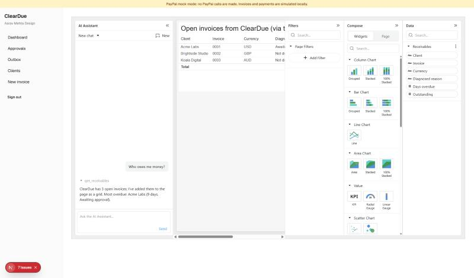

# Spike: AG Studio custom agent calling ClearDue

Branch `spike/ag-studio`, 2026-11-02. Goal: prove a custom agent tool can call a ClearDue server endpoint and render the result in Studio. No widgets, theming or polish.

## Result: go

What happened when "Who owes me money?" was clicked in Studio's AI Assistant (network log, in order):

1. `POST /api/analyst/run` → 200. Studio's `clientToolRunner` sent the run input (messages and the offered tools) to ClearDue. The server answered with AG-UI events, one JSON object per line: `TOOL_CALL_START` / `TOOL_CALL_ARGS` / `TOOL_CALL_END` for `get_receivables`.
2. `GET /api/analyst/receivables` → 200. Studio executed the custom client tool (`api.defineAiTool`). It fetched ClearDue's open invoices (signed-in session, our database), loaded them into a Studio data source, and added a grid widget with `api.setState`.
3. `POST /api/analyst/run` → 200. Studio resumed the run with the tool result, and the server answered with a text message: "ClearDue has 3 open invoices; I've added them to the page as a grid. Most overdue: Acme Labs (9 days, Awaiting approval)."

The grid "Open invoices from ClearDue (via the analyst's tool)" shows Acme Labs, Brightside Studio and Koala Digital, with currency and diagnosed reason.

## What was proven

- Custom tools: `api.defineAiTool({ name, description, params: (s) => s.object({...}), execute: async (args, ctx) => ctx.success(text, data) })`. `execute` runs in the browser, so it can call our authenticated endpoints with the session cookie.
- Custom agent: `clientToolRunner({ id, name, description, instructions, tools, run })` registered as the primary agent with `createAiHarness(api, () => ({ agents: [analyst], primary: "analyst" }))`. `run` returns an async iterable of AG-UI events, which we stream from our server as NDJSON. Studio owns the loop and resumes `run` after executing tools.
- Rendering: a tool can add data (React state passed to the `data` prop) and widgets (`api.getState` / `api.setState`) on the page.
- Fits our stack: `ag-studio` and `ag-studio-react` 3.0.0 install, typecheck and build with Next 16.4 / React 19.3. The Studio bundle (about 4.5 MB, 1.3 MB gzipped) is only referenced by `/analyst`.
- No key is needed during the trial: AG Studio logs "All AG Studio Pro with AI features are unlocked for trial" and shows a watermark. Next's dev overlay counts those console messages as issues.

## Not proven yet (the full build)

- **A real model behind `/api/analyst/run`.** The spike's server is scripted: the first round calls `get_receivables`, then it summarises. The full build maps an AI SDK `streamText` (Claude, `AI_MODEL`) onto the same events: text deltas become `TEXT_MESSAGE_*`, and tool calls become `TOOL_CALL_*`.
- Delegation to Studio's built-in agents (`lead`, `data`, `page`, `planning`, `widget` via `tools.delegateTo`). The built-ins need an `AgLlmAdapter` (the boilerplate's is OpenAI); for Claude we'd write a small adapter onto our server.
- `propose_action` through the mandate gate.
- Custom widgets and theming.
